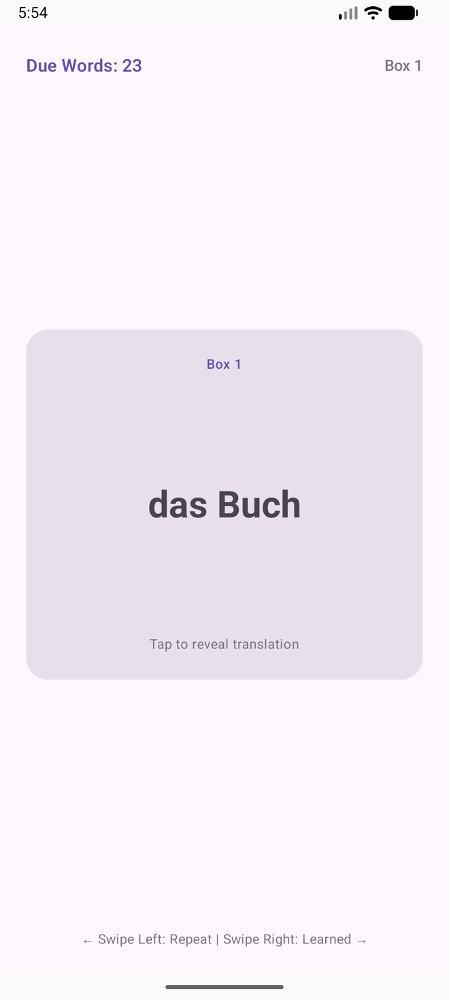
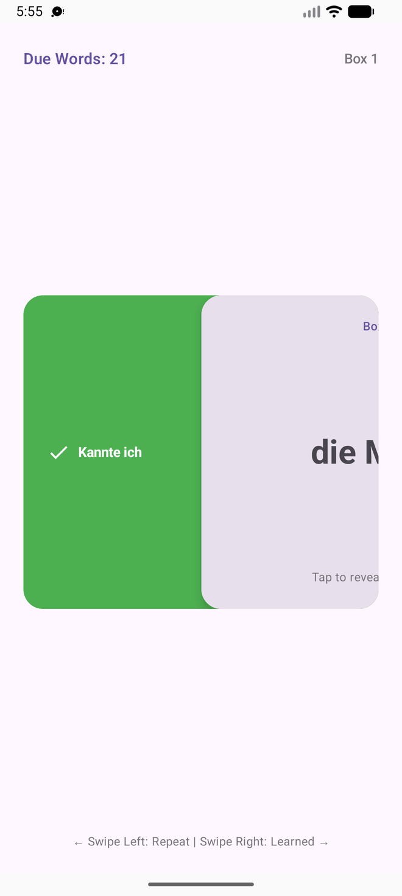
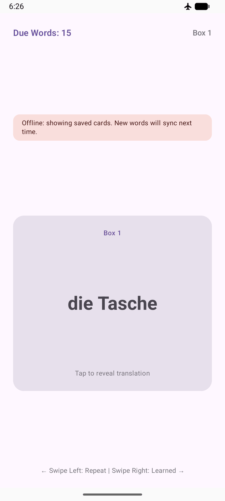
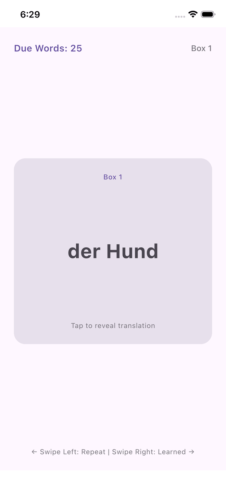
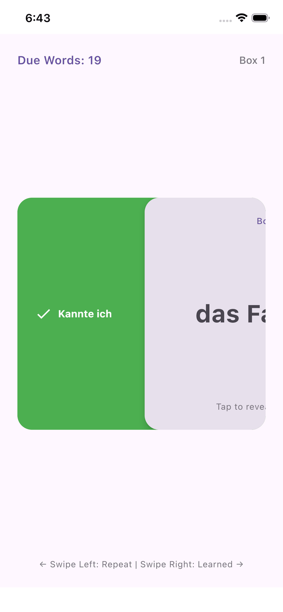
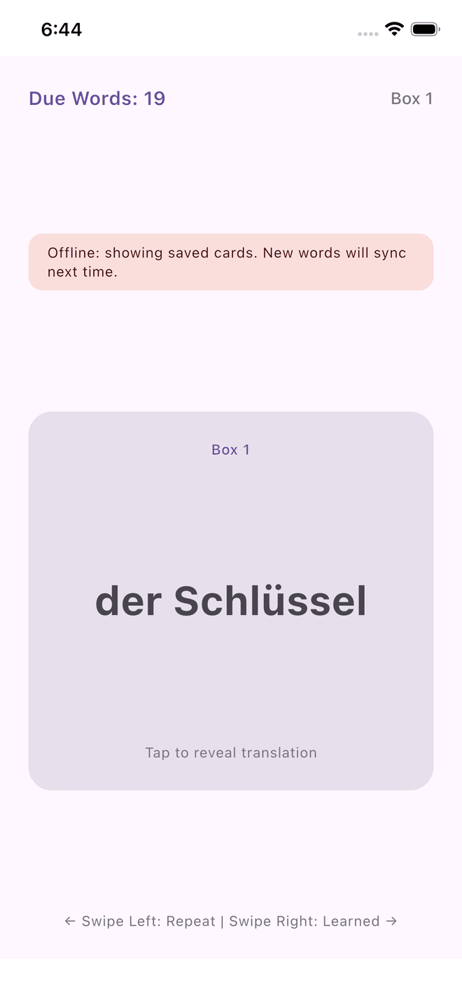
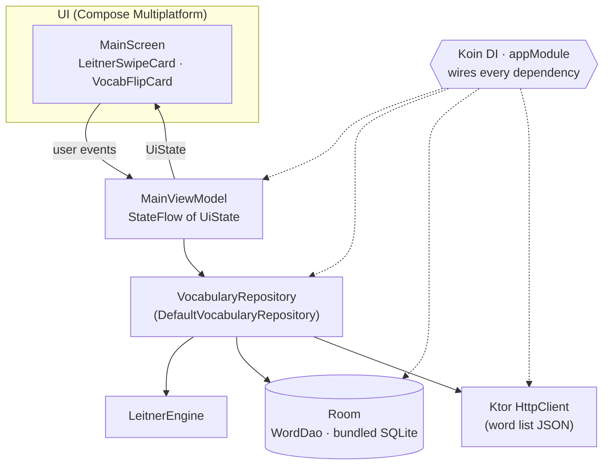

# MyGuru

[](https://github.com/Vishnu39/MyGuru/actions/workflows/ci.yml)
[](LICENSE)

A German vocabulary trainer for **Android and iOS** that uses the **Leitner spaced-repetition system**. It's built with **Kotlin Multiplatform and Compose Multiplatform**: UI, ViewModel, repository, database and networking all live in one shared module. Roughly **89% of the app's source lines are shared** (640 of 722 non-blank, non-import lines of Kotlin and Swift, not counting tests). The platform code is just the entry points, the database file location and the HTTP engine.

## Screenshots

|             | Flashcard | Swipe to grade | Offline mode |
| :---------- | :-------: | :------------: | :----------: |
| **Android** |  |  |  |
| **iOS**     |  |  |  |

## Features

- **Leitner spaced repetition:** five boxes with growing review intervals; correctly recalled words are mastered after box 5 ([details below](#how-the-leitner-engine-works)).
- **Flip and swipe cards:** tap a card for a 3D flip that reveals the English meaning and the article. Swipe right for *Kannte ich* (I knew it) or left for *Wiederholen* (repeat).
- **Re-practice in the same session:** a forgotten word drops back to box 1 and goes to the end of today's queue.
- **Offline-first:** progress is stored locally in Room (bundled SQLite), and only words that are due are queried.
- **Remote word list:** new words are downloaded from a JSON file with Ktor and merged into the local database without overwriting existing progress.
- **Graceful offline mode:** if the sync fails, the session keeps going with the saved cards and shows a small offline banner instead of an error screen.
- **One UI for both platforms:** Compose Multiplatform with Material 3. Android and iOS render the same composables.

## Tech stack

| Area | Library |
| :--- | :--- |
| Language | Kotlin 2.4 (Multiplatform) |
| UI | Compose Multiplatform 1.11, Material 3 |
| Architecture | MVVM with `StateFlow`, AndroidX Lifecycle ViewModel (multiplatform) |
| Persistence | Room KMP 2.8 with `sqlite-bundled`, KSP |
| Networking | Ktor 3.5 (OkHttp engine on Android, Darwin engine on iOS) |
| Serialization | kotlinx.serialization |
| Dependency injection | Koin 4.2 (`koin-compose-viewmodel`) |
| Async | Kotlin Coroutines 1.11 |
| Testing | `kotlin.test`, `kotlinx-coroutines-test`, Ktor `MockEngine`, hand-written fakes |
| CI | GitHub Actions (Ubuntu for Android, macOS for the iOS simulator) |

All versions are managed in the [version catalog](gradle/libs.versions.toml).

## Architecture



- **`MainViewModel`** exposes a single `UiState` (`Loading`, `ReviewSession`, `CompletedToday`, `Error`). The review queue is updated synchronously, so a duplicate swipe event can't record the same review twice.
- **`VocabularyRepository`** is an interface. The default implementation syncs the remote list into Room, reads the due cards, and saves each review using `LeitnerEngine`.
- **Koin** wires the database, DAO, `HttpClient`, repository and ViewModel. Android and iOS both start it from the shared `initKoin()`.

### Project layout

```text
MyGuru/
├── androidApp/                  # Android entry point (MainActivity)
├── iosApp/                      # Xcode project; SwiftUI hosts the shared Compose UI
└── shared/
    └── src/
        ├── commonMain/kotlin/com/vish/myguru/
        │   ├── core/
        │   │   ├── database/      # Room database, WordDao, WordEntity
        │   │   ├── designsystem/  # Colors, typography, spacing
        │   │   └── network/       # HttpClient factory
        │   ├── di/                # Koin appModule
        │   └── features/vocabulary/
        │       ├── model/         # Word, LeitnerEngine
        │       ├── repository/    # VocabularyRepository
        │       └── ui/            # MainViewModel, MainScreen, cards
        ├── commonTest/            # Shared unit tests (run on JVM and iOS)
        ├── androidMain/           # Application class, database path
        └── iosMain/               # MainViewController, database path
```

## How the Leitner engine works

[`LeitnerEngine`](shared/src/commonMain/kotlin/com/vish/myguru/features/vocabulary/model/LeitnerEngine.kt) is a pure function: `evaluate(currentBox, isCorrect, nowEpoch)` returns the next box, the next review time, and whether the word is mastered.

| Box | Interval |
| :-: | :------- |
| 1 | 1 day |
| 2 | 3 days |
| 3 | 7 days |
| 4 | 14 days |
| 5 | 30 days |

- **Correct:** the word moves up one box and is scheduled after that box's interval. For example, box 1 → box 2 means it's due again in 3 days.
- **Correct in box 5:** the word is **mastered** and drops out of future reviews.
- **Wrong:** the word goes back to **box 1** and is due again immediately, so it's repeated later in the same session.

New words start in box 1 and are due straight away.

## Testing

There are **35 unit tests in `commonTest`**. CI runs them on the **JVM** (Android host tests) and on the **iOS simulator**.

| Test class | Tests | Covers |
| :--- | :-: | :--- |
| `LeitnerEngineTest` | 8 | Box promotions and intervals, mastering, resets, a full progression |
| `MainViewModelTest` | 19 | Session states, sync failures, review queue, duplicate-swipe guard |
| `DefaultVocabularyRepositoryTest` | 8 | Sync via Ktor `MockEngine`, progress preserved on re-sync, error handling, review persistence |

```bash
./gradlew :shared:testAndroidHostTest      # JVM
./gradlew :shared:iosSimulatorArm64Test    # iOS simulator (macOS only)
```

[CI](.github/workflows/ci.yml) builds the Android debug APK and runs the JVM tests on Ubuntu, and runs the iOS simulator tests on macOS, for every pull request and every push to `main`.

## Build and run

**Requirements:** JDK 21, the Android SDK (compileSdk 36, minSdk 24), and for iOS, macOS with Xcode 16.2+ (deployment target iOS 18.2).

### Android

```bash
./gradlew :androidApp:assembleDebug
```

Or open the project in Android Studio and run the `androidApp` configuration.

### iOS

```bash
open iosApp/iosApp.xcodeproj
```

Pick a simulator or device and press **Run**. The Xcode build phase calls `./gradlew :shared:embedAndSignAppleFrameworkForXcode` to build the shared framework.

## License

```text
Copyright 2026 Vishnu CR

Licensed under the Apache License, Version 2.0 (the "License");
you may not use this file except in compliance with the License.
You may obtain a copy of the License at

    http://www.apache.org/licenses/LICENSE-2.0

Unless required by applicable law or agreed to in writing, software
distributed under the License is distributed on an "AS IS" BASIS,
WITHOUT WARRANTIES OR CONDITIONS OF ANY KIND, either express or implied.
See the License for the specific language governing permissions and
limitations under the License.
```

See [LICENSE](LICENSE) for the full text.
